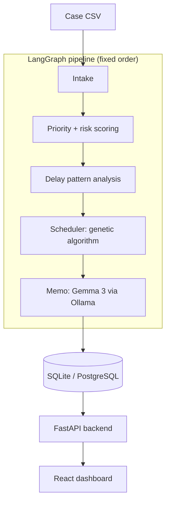

# JudicAI | The Modern Magistrate

[](https://opensource.org/licenses/MIT)
[](https://www.python.org/)
[](https://nodejs.org/)
[](https://fastapi.tiangolo.com/)
[](https://reactjs.org/)
[](https://tailwindcss.com/)
[](https://github.com/SujitSpark/JudicAi/actions/workflows/ci.yml)

**JudicAI** is a hackathon prototype (built in 8 hours) that helps a court registry decide which pending cases need attention first. It ranks cases by priority and by the risk that the next hearing gets adjourned, suggests hearing slots, and drafts short listing memos for the most urgent cases.

> All data in this repository is **synthetic**: 100 generated cases (`data/supreme_court_100.csv`) and a 1,200-case benchmark derived from them. No real court records are used.

---

## 🏛️ Why
India has a backlog of over 50 million pending cases, and much of the delay comes from repeated adjournments. JudicAI explores whether simple, explainable scoring of case metadata (age, adjournments, case type, parties) can surface the cases most likely to stall, so a registry can act on them earlier.

---

## ✨ What it does

| Step | How it works | Notes |
| :--- | :--- | :--- |
| **Intake** | Reads a CSV of case records, cleans and validates it, derives case age. | CSV only |
| **Priority** | Weighted rule score (0-100) from age, adjournments, case type and parties. | Benchmarked ([results](benchmarks/README.md)) |
| **Adjournment risk** | Rule engine blended with an XGBoost model (0.9 rule + 0.1 ML); 80+ is flagged critical. | The ML part alone is near random after the leakage fix |
| **Scheduling** | A genetic algorithm (DEAP) assigns hearing slots, balancing judge load. | |
| **Memos** | Drafts a short listing memo for cases above 65 priority or risk with Gemma 3 12B run locally through Ollama; falls back to a template if Ollama isn't running. | Only step that uses an LLM |

The steps run in a fixed order as a LangGraph `StateGraph` (`backend/app/core/supervisor.py`); the "supervisor" is a rule-based router, not an LLM.

---

## 📊 Benchmark & Testing

JudicAI's triage agents are evaluated on a **1,200-case synthetic benchmark** modelled on
100 synthetic seed cases in the style of Supreme Court matters (see [`benchmarks/`](benchmarks/README.md)), against the manual
"oldest case first" order a registry clerk would use:

| Ranking | ROC-AUC | Precision @ top 20% | Review effort saved |
|---|---|---|---|
| Manual (oldest first) | 0.51 | 43% | — |
| Risk agent (rule engine) | 0.60 | 49% | 9% |
| Proposed supervised stall classifier | **0.65** | **59%** | **15%** |

The benchmark exposed and fixed **target leakage** in the risk model (it scored a meaningless
R² of 1.00 by reading its own target; R² is 0.67 once fixed), negative risk scores, and an
index-alignment bug. `pytest tests` covers scoring, the leakage guard and the generator, and
runs in CI.

---

## 🏗️ System Architecture



### 🧩 Sub-System Component Architecture & Flows
Below are the visual reference diagrams detailing the sub-system block architecture and agent-entity interaction flows:

| Sub-System Component Relationships | Agent Entity Interaction Flows |
| :---: | :---: |
|  |  |

---

## 🚀 Getting Started

### 1. Prerequisites
- **Python 3.10+** (Backend)
- **Node.js 18+** (Frontend)
- **PostgreSQL** (Optional, defaults to SQLite)

### 2. Installation & Setup

#### Backend Setup
```bash
cd backend
# 1. Install dependencies
pip install -r requirements.txt

# 2. Configure Environment
# Copy the template and fill in your keys
cp ../.env.example .env

# 3. Launch the API
uvicorn app.main:app --reload
```

#### Frontend Setup
```bash
cd frontend
# 1. Install dependencies
npm install

# 2. Start the Development Server
npm run dev
```

### 3. Database Seeding
Populate the system with a synthetic Supreme Court dataset (100 cases and a full 34-judge bench):
```bash
python scripts/seed_supreme_court.py
```

---

### 4. Frontend-only demo (no backend)
`frontend/public/demo/` holds a static snapshot of the pipeline's output on the 100 synthetic cases.
Build with `VITE_DEMO=true` to serve the dashboard from it, read-only, with a "synthetic data" banner:
```bash
cd frontend
VITE_DEMO=true npm run build   # deploy frontend/dist to Vercel, Netlify or GitHub Pages
```
To refresh the snapshot, seed a database and export it:
```bash
DATABASE_URL=sqlite:///demo.db python scripts/seed_supreme_court.py
DATABASE_URL=sqlite:///demo.db python scripts/export_demo_snapshot.py
```

---

## 🛠️ Tech Stack

- **Intelligence**: LangGraph (pipeline orchestration), XGBoost, DEAP (genetic-algorithm scheduler), Gemma 3 12B via Ollama (local, memo generation only).
- **Backend**: FastAPI (Python), SQLAlchemy ORM, Pydantic v2.
- **Frontend**: React 18, Vite, Tailwind CSS, Framer Motion (Animations).
- **Visualization**: Recharts, Lucide Icons.
- **Data Engineering**: Pandas, NumPy.

---

## 📂 Project Structure

```text
JudicAi/
├── backend/            # FastAPI Application
│   ├── app/            # Core logic, Agents, API, DB
│   └── requirements.txt
├── frontend/           # Vite + React Application
│   ├── src/            # Components, Pages, State
│   └── package.json
├── data/               # CSV datasets and synthetic data
├── scripts/            # Database seeding and utility scripts
├── .env.example        # Environment template
└── Readme.md           # You are here
```

---

## 🤝 Contributing
Contributions are what make the open-source community an amazing place to learn, inspire, and create. Any contributions you make are **greatly appreciated**.

---
*Built with precision for the modern judiciary.*
